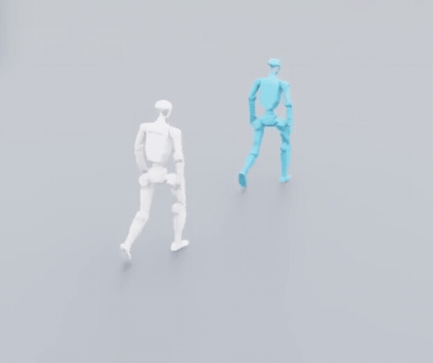

# G1 SuperMimic

Unofficial G1 motion tracking based on [SuperMimic](https://arxiv.org/abs/2610.28480), with world-model training and Isaac Lab visualization.

[](docs/media/g1-mimic.mp4)

Gray: policy rollout. Blue: reference motion.

## Environment

- Python 3.11
- PyTorch 2.7.0 / CUDA 12.6
- Warp 1.18.0+cu12 / mjlab 1.6.0 / MuJoCo Warp 3.11.0
- Isaac Lab 2.3.2 / Isaac Sim 5.1 (separate Python environment)

## Data

Convert BONES-SEED G1 motions into 50 Hz NPZ clips and a manifest before training.
The converter accepts a CSV file, directory or G1 archive.

```bash
export G1_DATA_ROOT=/path/to/bones-seed
uv run --locked g1-convert-motion \
  --source "$G1_DATA_ROOT/g1.tar.gz" \
  --output "$G1_DATA_ROOT/converted" --limit 5
export G1_MOTION_FILE="$G1_DATA_ROOT/converted/manifest.json"
```

## Training

```bash
uv run --locked g1-train --config configs/motion.json \
  --motion-file "$G1_MOTION_FILE"
```

## Evaluation

```bash
export G1_CHECKPOINT="$PWD/runs/motion/model_010000.pt"
uv run --locked g1-eval --checkpoint "$G1_CHECKPOINT" \
  --motion-file "$G1_MOTION_FILE" \
  --seconds 20 --output runs/motion/eval.json
```

## Isaac Lab visualization

Run from a desktop session. Gray is the policy-controlled robot; blue is the reference.

```bash
uv run --locked python scripts/export_isaac_asset.py --output assets/isaac_g1
export ISAACLAB_PYTHON=/path/to/isaaclab/environment/bin/python
"$ISAACLAB_PYTHON" scripts/play_isaaclab.py \
  --checkpoint "$G1_CHECKPOINT" \
  --motion-file "$G1_MOTION_FILE" \
  --bundle assets/isaac_g1/control.json
```

## License

[MIT](LICENSE).

Training data includes **Motion Data by Bones Studio** ([bones.studio](https://bones.studio/)).
Use of the underlying dataset is subject to the BONES Motion Capture Dataset License Agreement.
